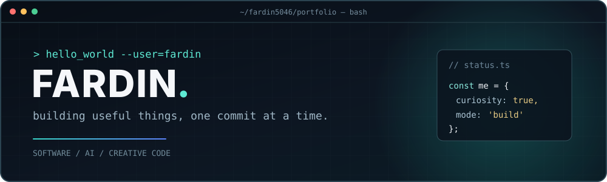
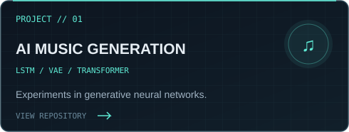
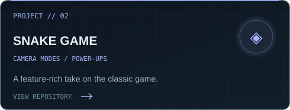
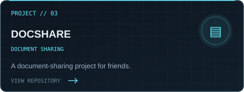
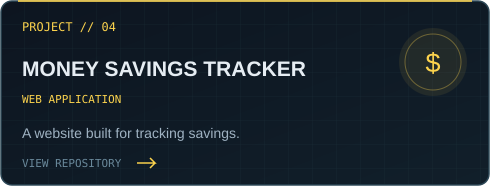

 

<code>open to ideas</code> &nbsp;·&nbsp; <code>building in public</code> &nbsp;·&nbsp; <code>curious by default</code>

### `> whoami`

I'm **Fardin** — a developer who enjoys building practical applications, experimenting with machine learning, and making ideas real.

- 🧩 I like **software tools**, **web applications**, and **creative coding**.
- 🧠 I explore **generative AI** and neural-network projects.
- 🛠️ Currently designing **Clipflow**, a compact Windows clipboard manager *(work in progress; not yet a public repository)*.
- ✨ My approach: **keep the interface clean, make the details count**.

### `> toolbox --list`

  
  
  
  
  
  

### `> ls ./featured-projects`

<table>
  <tr>
    <td width="50%"></td>
    <td width="50%"></td>
  </tr>
  <tr>
    <td width="50%"></td>
    <td width="50%"></td>
  </tr>
</table>

<a href="https://github.com/Fardin5046?tab=repositories">browse all repositories →</a>

### `> git stats --live`

  
  

### `> ./contribution-snake.sh`

  <picture>
    <source media="(prefers-color-scheme: dark)" srcset="https://raw.githubusercontent.com/Fardin5046/Fardin5046/output/github-snake-dark.svg" />
    <source media="(prefers-color-scheme: light)" srcset="https://raw.githubusercontent.com/Fardin5046/Fardin5046/output/github-snake.svg" />
    
  </picture>
   
  The snake appears after the included GitHub Action runs successfully for the first time.

---

  <code>fardin5046@github:~$</code> keep building. keep learning. <code>█</code>

